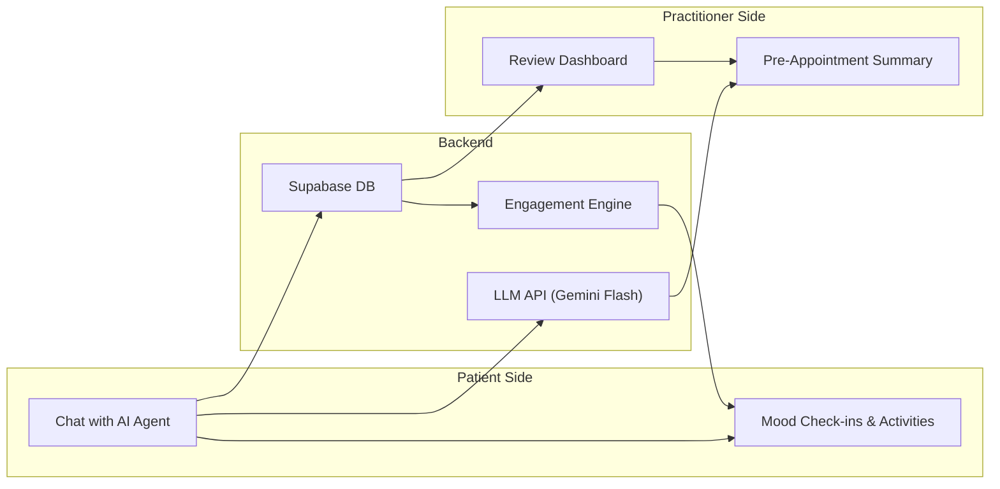

# 🧠 MagdeHack — Mental Health Bridge App: Development Plan

> **Challenge #2**: _Lange Wartezeiten auf Psychotherapie_ — A digital bridge for patients waiting months for a psychotherapy slot.

---

## 1. App Overview

A web application with an **empathetic AI chatbot**, a **smart engagement engine**, a **practitioner review dashboard**, and a **pre-appointment summary generator** — all designed to keep patients supported during the long wait for therapy.



---

## 2. Tech Stack

| Layer | Technology | Why |
|---|---|---|
| **Frontend** | Next.js 14 (App Router) + Tailwind CSS + shadcn/ui | Fast SSR, great DX, beautiful components |
| **Backend / API** | Next.js API Routes (Route Handlers) | Keeps everything in one repo |
| **Database** | Supabase (PostgreSQL + Auth + Realtime + Storage) | Free tier, instant auth, row-level security |
| **AI / LLM** | Google Gemini Flash (free tier) | Free for prototyping, generous limits |
| **Deployment (local first)** | `localhost:3000` via `next dev` | Develop & demo locally |
| **Deployment (cloud)** | Google Cloud Run _or_ Vercel | Containerized deploy to GCP, or Vercel for simplicity |

---

## 3. Environment Variables & Keys You'll Need

> [!IMPORTANT]
> Create a `.env.local` file at the project root. **Never commit this file to git.**

```env
# ──────────────────────────────────────
# SUPABASE (get from: https://supabase.com/dashboard → your project → Settings → API)
# ──────────────────────────────────────
NEXT_PUBLIC_SUPABASE_URL=https://<your-project-ref>.supabase.co
NEXT_PUBLIC_SUPABASE_ANON_KEY=eyJ...              # public anon key (safe for client)
SUPABASE_SERVICE_ROLE_KEY=eyJ...                   # secret service-role key (server only!)

# ──────────────────────────────────────
# GOOGLE GEMINI AI  (get from: https://aistudio.google.com/apikey)
# ──────────────────────────────────────
GEMINI_API_KEY=AIza...                             # Google AI Studio API key

# ──────────────────────────────────────
# FOR CLOUD DEPLOYMENT (GCP Cloud Run) — needed later
# ──────────────────────────────────────
# GCP_PROJECT_ID=your-gcp-project-id
# GCP_REGION=europe-west3                          # Frankfurt — closest to Magdeburg
```

### Where to get each key:

| Key | Where to get it | Cost |
|---|---|---|
| `NEXT_PUBLIC_SUPABASE_URL` | [Supabase Dashboard](https://supabase.com/dashboard) → Project → Settings → API | **Free** (free tier: 500MB DB, 1GB storage, 50k monthly active users) |
| `NEXT_PUBLIC_SUPABASE_ANON_KEY` | Same page as above | **Free** |
| `SUPABASE_SERVICE_ROLE_KEY` | Same page as above (⚠️ keep secret!) | **Free** |
| `GEMINI_API_KEY` | [Google AI Studio](https://aistudio.google.com/apikey) — sign in with Google account, create key | **Free** (free tier, no credit card needed) |
| `GCP_PROJECT_ID` | [GCP Console](https://console.cloud.google.com) — create project (only for cloud deploy) | Free tier available; Cloud Run has generous free tier |

---

## 4. Free AI/LLM Options for This Demo

> [!TIP]
> **Recommended: Google Gemini Flash (free tier)** — Since this is for a Gemini-focused hackathon, it's the natural fit. No credit card required, generous rate limits.

| Provider | Model | Free Tier | Best For | API Compatibility |
|---|---|---|---|---|
| **🥇 Google Gemini** | `gemini-3.8-flash` | ✅ Free, no CC needed. Rate-limited per project (RPM/TPM/RPD) | **This hackathon** — native Gemini use | Google AI SDK (`@google/generative-ai`) |
| **🥈 Groq** | `llama-3.3-70b` | ✅ Free forever, no CC. ~6,000–30,000 TPM | Blazing speed (300+ tok/s) if you want a fallback | OpenAI-compatible `/v1/chat/completions` |
| **🥉 OpenRouter** | Various `:free` models | ✅ Free, 20 RPM, 50 req/day (1,000 with \$10 deposit) | Model variety & failover | OpenAI-compatible |

### How to get each:
1. **Gemini**: Go to [aistudio.google.com/apikey](https://aistudio.google.com/apikey), sign in, click "Create API Key" → done.
2. **Groq** (backup): Go to [console.groq.com](https://console.groq.com), sign up, create API key → done.
3. **OpenRouter** (backup): Go to [openrouter.ai/keys](https://openrouter.ai/keys), sign up, create key → done.

> [!NOTE]
> For the hackathon demo, **Gemini Flash alone is sufficient**. The free tier gives you enough requests for a compelling live demo. Only add Groq/OpenRouter if you want a fallback or want to demonstrate multi-model support.

---

## 5. Database Schema (Supabase / PostgreSQL)

```sql
-- Users (extends Supabase Auth)
CREATE TABLE profiles (
  id UUID PRIMARY KEY REFERENCES auth.users(id) ON DELETE CASCADE,
  role TEXT NOT NULL CHECK (role IN ('patient', 'practitioner', 'admin')),
  full_name TEXT,
  created_at TIMESTAMPTZ DEFAULT now()
);

-- AI Profiling data (from initial conversational intake)
CREATE TABLE patient_profiles (
  id UUID PRIMARY KEY DEFAULT gen_random_uuid(),
  user_id UUID REFERENCES profiles(id) ON DELETE CASCADE,
  primary_concerns TEXT[],           -- e.g. ['anxiety', 'sleep_issues', 'stress']
  daily_routine JSONB,               -- structured daily routine info
  interaction_style TEXT,            -- 'direct' | 'gentle' | 'neutral'
  triggers TEXT[],                   -- identified triggers
  preferences JSONB,                 -- misc preferences
  profiling_complete BOOLEAN DEFAULT false,
  created_at TIMESTAMPTZ DEFAULT now(),
  updated_at TIMESTAMPTZ DEFAULT now()
);

-- Chat conversations
CREATE TABLE conversations (
  id UUID PRIMARY KEY DEFAULT gen_random_uuid(),
  user_id UUID REFERENCES profiles(id) ON DELETE CASCADE,
  started_at TIMESTAMPTZ DEFAULT now(),
  ended_at TIMESTAMPTZ
);

-- Individual chat messages
CREATE TABLE messages (
  id UUID PRIMARY KEY DEFAULT gen_random_uuid(),
  conversation_id UUID REFERENCES conversations(id) ON DELETE CASCADE,
  role TEXT NOT NULL CHECK (role IN ('user', 'assistant', 'system')),
  content TEXT NOT NULL,
  sentiment_score FLOAT,             -- -1.0 to 1.0
  crisis_flag BOOLEAN DEFAULT false,
  created_at TIMESTAMPTZ DEFAULT now()
);

-- Mood check-ins (engagement engine)
CREATE TABLE mood_entries (
  id UUID PRIMARY KEY DEFAULT gen_random_uuid(),
  user_id UUID REFERENCES profiles(id) ON DELETE CASCADE,
  mood_score INTEGER CHECK (mood_score BETWEEN 1 AND 10),
  energy_level INTEGER CHECK (energy_level BETWEEN 1 AND 10),
  sleep_quality INTEGER CHECK (sleep_quality BETWEEN 1 AND 10),
  notes TEXT,
  created_at TIMESTAMPTZ DEFAULT now()
);

-- Engagement activities (pushed to patients)
CREATE TABLE activities (
  id UUID PRIMARY KEY DEFAULT gen_random_uuid(),
  title TEXT NOT NULL,
  description TEXT,
  category TEXT NOT NULL,            -- 'breathing', 'journaling', 'psychoeducation', 'grounding'
  duration_minutes INTEGER,
  time_of_day TEXT,                  -- 'morning', 'afternoon', 'evening', 'anytime'
  target_concerns TEXT[]             -- which concerns this activity addresses
);

-- Activity log (what the patient completed)
CREATE TABLE activity_log (
  id UUID PRIMARY KEY DEFAULT gen_random_uuid(),
  user_id UUID REFERENCES profiles(id) ON DELETE CASCADE,
  activity_id UUID REFERENCES activities(id),
  completed BOOLEAN DEFAULT false,
  feedback TEXT,
  created_at TIMESTAMPTZ DEFAULT now()
);

-- Practitioner reviews
CREATE TABLE reviews (
  id UUID PRIMARY KEY DEFAULT gen_random_uuid(),
  practitioner_id UUID REFERENCES profiles(id),
  conversation_id UUID REFERENCES conversations(id),
  rating INTEGER CHECK (rating BETWEEN 1 AND 5),
  notes TEXT,
  flagged BOOLEAN DEFAULT false,
  created_at TIMESTAMPTZ DEFAULT now()
);

-- Risk/Severity scores (AI-generated, practitioner-monitored)
CREATE TABLE risk_scores (
  id UUID PRIMARY KEY DEFAULT gen_random_uuid(),
  user_id UUID REFERENCES profiles(id) ON DELETE CASCADE,
  score FLOAT CHECK (score BETWEEN 0 AND 1),
  factors JSONB,                     -- what contributed to this score
  generated_at TIMESTAMPTZ DEFAULT now()
);

-- Pre-appointment summaries
CREATE TABLE summaries (
  id UUID PRIMARY KEY DEFAULT gen_random_uuid(),
  user_id UUID REFERENCES profiles(id) ON DELETE CASCADE,
  ai_summary TEXT,
  practitioner_approved BOOLEAN DEFAULT false,
  approved_by UUID REFERENCES profiles(id),
  approved_at TIMESTAMPTZ,
  exported BOOLEAN DEFAULT false,
  created_at TIMESTAMPTZ DEFAULT now()
);

-- Row Level Security (RLS) policies
ALTER TABLE profiles ENABLE ROW LEVEL SECURITY;
ALTER TABLE patient_profiles ENABLE ROW LEVEL SECURITY;
ALTER TABLE conversations ENABLE ROW LEVEL SECURITY;
ALTER TABLE messages ENABLE ROW LEVEL SECURITY;
ALTER TABLE mood_entries ENABLE ROW LEVEL SECURITY;
```

---

## 6. Design Theme — Clean White & Green 🌿

A calming, professional aesthetic. No neon, no dark "AI" vibes. Think healthcare wellness.

| Token | Value | Usage |
|---|---|---|
| **Background** | `#FFFFFF` / `#F8FAF8` | Page backgrounds |
| **Surface** | `#F0F5F0` | Cards, panels, chat bubbles (assistant) |
| **Primary** | `#22C55E` (green-500) | Buttons, active states, accents |
| **Primary hover** | `#16A34A` (green-600) | Button hover |
| **Primary light** | `#DCFCE7` (green-100) | Badges, highlights, soft backgrounds |
| **Primary subtle** | `#BBF7D0` (green-200) | Borders, dividers |
| **Text primary** | `#1A1A1A` | Headings, body |
| **Text secondary** | `#6B7280` (gray-500) | Captions, timestamps |
| **User chat bubble** | `#22C55E` with white text | Patient's messages |
| **AI chat bubble** | `#F0F5F0` with dark text | AI responses |
| **Danger/Crisis** | `#EF4444` (red-500) | Crisis alerts, flags |
| **Warning** | `#F59E0B` (amber-500) | Risk scores, attention |

```css
/* Tailwind CSS theme extension (tailwind.config.ts) */
theme: {
  extend: {
    colors: {
      brand: {
        50:  '#F0FDF4',
        100: '#DCFCE7',
        200: '#BBF7D0',
        300: '#86EFAC',
        400: '#4ADE80',
        500: '#22C55E',
        600: '#16A34A',
        700: '#15803D',
      }
    }
  }
}
```

**Fonts**: Inter (body) + optional serif for headings to feel warm, not techy.

---

## 6b. Project Structure

```
magdehack/
├── .env.local                    # 🔒 YOUR KEYS GO HERE
├── package.json
├── next.config.js
├── tailwind.config.ts
├── tsconfig.json
│
├── src/
│   ├── app/
│   │   ├── layout.tsx            # Root layout with providers
│   │   ├── page.tsx              # Landing / login page
│   │   ├── (auth)/
│   │   │   ├── login/page.tsx
│   │   │   └── register/page.tsx
│   │   ├── (patient)/
│   │   │   ├── chat/page.tsx          # AI chat interface
│   │   │   ├── profile/page.tsx       # View/edit profiling data
│   │   │   ├── activities/page.tsx    # Engagement activities
│   │   │   └── mood/page.tsx          # Mood tracking
│   │   ├── (practitioner)/
│   │   │   ├── dashboard/page.tsx     # Review dashboard
│   │   │   ├── patients/page.tsx      # Patient list with risk scores
│   │   │   └── review/[id]/page.tsx   # Review specific conversation
│   │   └── api/
│   │       ├── chat/route.ts          # AI chat endpoint
│   │       ├── profile/route.ts       # Profiling endpoint
│   │       ├── summary/route.ts       # Summary generation
│   │       └── engagement/route.ts    # Activity scheduling
│   │
│   ├── components/
│   │   ├── ui/                   # shadcn/ui components
│   │   ├── chat/
│   │   │   ├── ChatWindow.tsx
│   │   │   ├── MessageBubble.tsx
│   │   │   └── ProfilingFlow.tsx
│   │   ├── dashboard/
│   │   │   ├── PatientCard.tsx
│   │   │   ├── RiskScoreChart.tsx
│   │   │   └── ReviewPanel.tsx
│   │   └── engagement/
│   │       ├── MoodTracker.tsx
│   │       └── ActivityCard.tsx
│   │
│   ├── lib/
│   │   ├── supabase/
│   │   │   ├── client.ts         # Browser Supabase client
│   │   │   ├── server.ts         # Server Supabase client
│   │   │   └── middleware.ts     # Auth middleware
│   │   ├── gemini.ts             # Gemini AI client + system prompts
│   │   ├── guardrails.ts         # Crisis detection, keyword analysis
│   │   ├── engagement.ts         # Scheduling algorithm
│   │   └── summary.ts            # Summary generation logic
│   │
│   └── types/
│       └── index.ts              # TypeScript types
│
└── supabase/
    └── migrations/               # SQL migration files
        └── 001_initial_schema.sql
```

---

## 7. Build Phases — Step-by-Step

### Phase 1: Foundation & AI Chatbot 🏗️
**Goal**: Working chat interface with Gemini-powered AI agent + initial profiling flow

| Step | Task | Details |
|---|---|---|
| 1.1 | **Scaffold Next.js project** | `npx create-next-app@latest magdehack --typescript --tailwind --app --src-dir` |
| 1.2 | **Install dependencies** | `pnpm add @supabase/supabase-js @supabase/ssr @google/generative-ai` |
| 1.3 | **Set up Supabase project** | Create project at supabase.com, run SQL schema, copy keys to `.env.local` |
| 1.4 | **Implement Auth** | Login/Register with Supabase Auth (email + password) |
| 1.5 | **Build Chat UI** | `ChatWindow`, `MessageBubble`, streaming responses |
| 1.6 | **Integrate Gemini API** | Server-side route handler calling Gemini Flash with system prompt |
| 1.7 | **Create AI system prompt** | Empathetic, non-diagnostic persona with strict guardrails |
| 1.8 | **Build Profiling Flow** | On first login → conversational profiling → store structured data |
| 1.9 | **Crisis detection** | Keyword + sentiment analysis → emergency hotline routing |

> **System Prompt Core** (for the AI agent):
> ```
> You are a compassionate, empathetic mental health support companion.
> You MUST NOT: diagnose conditions, prescribe medication, or provide
> clinical treatment. If a user expresses thoughts of self-harm or
> severe distress, immediately provide the German crisis hotline:
> Telefonseelsorge 0800 111 0 111 (24/7, free).
> ```

### Phase 2: Engagement Engine ⚡
**Goal**: Smart activity scheduling based on patient profile

| Step | Task |
|---|---|
| 2.1 | Build activity modules (breathing exercises, journaling prompts, psychoeducation) |
| 2.2 | Implement mood tracking UI (1-10 scales, notes) |
| 2.3 | Create scheduling algorithm that maps profile → activity type + timing |
| 2.4 | Adaptive pacing: reduce pushes if patient is active, gentle pings if silent |
| 2.5 | Notification system (in-app notifications) |

### Phase 3: Practitioner Dashboard 👨‍⚕️
**Goal**: Secure review interface for part-time practitioners

| Step | Task |
|---|---|
| 3.1 | Practitioner auth with role-based access (RLS policies) |
| 3.2 | Patient list view with risk/severity score ranking |
| 3.3 | Conversation review panel with patient profile context sidebar |
| 3.4 | AI response rating system (for RLHF feedback loop) |
| 3.5 | Flagging & intervention triggers |

### Phase 4: Pre-Appointment Summary 📋
**Goal**: AI-generated clinical brief, validated by practitioner, exportable as PDF

| Step | Task |
|---|---|
| 4.1 | AI summarization prompt: condense profile + months of data → 1-page brief |
| 4.2 | Practitioner review & sign-off workflow |
| 4.3 | PDF export (using a library like `@react-pdf/renderer`) |
| 4.4 | Secure delivery mechanism (download link / email) |

---

## 8. Key Gemini Integration Code Patterns

### Gemini Client Setup (`src/lib/gemini.ts`)

```typescript
import { GoogleGenerativeAI } from "@google/generative-ai";

const genAI = new GoogleGenerativeAI(process.env.GEMINI_API_KEY!);

export const chatModel = genAI.getGenerativeModel({
  model: "gemini-2.0-flash",  // free tier model
  systemInstruction: `You are a compassionate mental health support companion
    for patients waiting for psychotherapy in Germany. You provide emotional
    support, active listening, and coping strategies. You NEVER diagnose,
    prescribe, or replace professional therapy. If crisis detected, provide:
    Telefonseelsorge 0800 111 0 111.`,
});

export const summaryModel = genAI.getGenerativeModel({
  model: "gemini-2.0-flash",
  systemInstruction: `You are a clinical summarization assistant. Condense
    patient interaction history into a structured 1-page pre-appointment
    brief for the treating psychiatrist/psychotherapist.`,
});
```

### Chat API Route (`src/app/api/chat/route.ts`)

```typescript
import { chatModel } from "@/lib/gemini";
import { createClient } from "@/lib/supabase/server";
import { NextRequest, NextResponse } from "next/server";

export async function POST(req: NextRequest) {
  const supabase = await createClient();
  const { data: { user } } = await supabase.auth.getUser();
  if (!user) return NextResponse.json({ error: "Unauthorized" }, { status: 401 });

  const { message, conversationId } = await req.json();

  // Fetch conversation history
  const { data: history } = await supabase
    .from("messages")
    .select("role, content")
    .eq("conversation_id", conversationId)
    .order("created_at", { ascending: true });

  // Build chat with history
  const chat = chatModel.startChat({
    history: history?.map(m => ({
      role: m.role === "assistant" ? "model" : "user",
      parts: [{ text: m.content }],
    })) ?? [],
  });

  const result = await chat.sendMessage(message);
  const response = result.response.text();

  // Save both messages to DB
  await supabase.from("messages").insert([
    { conversation_id: conversationId, role: "user", content: message },
    { conversation_id: conversationId, role: "assistant", content: response },
  ]);

  return NextResponse.json({ response });
}
```

---

## 9. Running Locally

```bash
# 1. Clone and install
cd d:\office dowmloads\magdehack
npx create-next-app@latest app --typescript --tailwind --app --src-dir
cd app
pnpm add @supabase/supabase-js @supabase/ssr @google/generative-ai

# 2. Add your keys to .env.local (see Section 3)

# 3. Run the dev server
pnpm dev
# → Open http://localhost:3000
```

---

## 10. Cloud Deployment Checklist (Later)

When ready to deploy to **Google Cloud Run**:

| Step | What | Key/Config Needed |
|---|---|---|
| 1 | Create GCP project | `GCP_PROJECT_ID` |
| 2 | Enable Cloud Run API | — |
| 3 | Create `Dockerfile` | Multi-stage Next.js build |
| 4 | Set env vars in Cloud Run | All `.env.local` vars as Cloud Run secrets |
| 5 | Deploy | `gcloud run deploy magdehack --region=europe-west3` |
| 6 | Custom domain (optional) | DNS configuration |

> [!NOTE]
> **Cloud Run free tier** includes 2 million requests/month, 360,000 GB-seconds of memory, and 180,000 vCPU-seconds — more than enough for a demo.

---

## 11. Summary: All Keys You Need to Provide

| # | Key | Where to Get | When Needed |
|---|---|---|---|
| 1 | `NEXT_PUBLIC_SUPABASE_URL` | Supabase Dashboard → Settings → API | **Now** (Phase 1) |
| 2 | `NEXT_PUBLIC_SUPABASE_ANON_KEY` | Same | **Now** (Phase 1) |
| 3 | `SUPABASE_SERVICE_ROLE_KEY` | Same | **Now** (Phase 1) |
| 4 | `GEMINI_API_KEY` | [aistudio.google.com/apikey](https://aistudio.google.com/apikey) | **Now** (Phase 1) |
| 5 | `GCP_PROJECT_ID` | GCP Console | Later (deploy) |
| 6 | `GCP_REGION` | Choose `europe-west3` (Frankfurt) | Later (deploy) |

> [!CAUTION]
> **GDPR Note**: The Gemini free tier allows Google to use your prompts for training. For a production mental health app, you MUST use the **paid tier** (or Vertex AI) which has enterprise data privacy terms. For a hackathon demo, the free tier is acceptable.

---

## 12. Immediate Next Steps

1. **You** → Create a Supabase project and share the 3 keys
2. **You** → Go to [aistudio.google.com/apikey](https://aistudio.google.com/apikey) and create a Gemini API key
3. **I** → Scaffold the Next.js project, set up Supabase auth, and build Phase 1 (chat + profiling)

Ready to start building? 🚀
